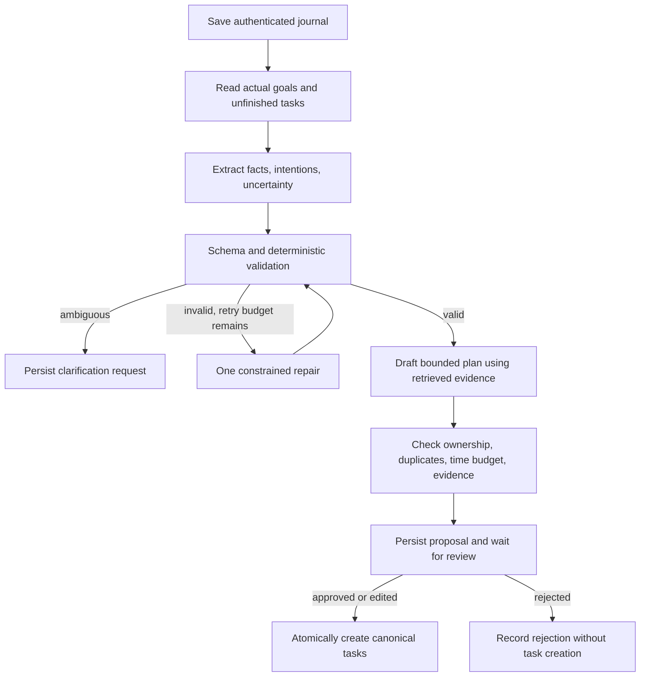

# AI engineering: current behavior and upgrade design

> Baseline audit snapshot, before the implementation changes. See [current implementation](current-implementation.md), [progress tracker](implementation-progress.md), and [verification results](verification-results.md) for the updated state.

## Existing model integrations

All active generation uses `google-genai` and `gemini-2.5-flash`. These are synchronous SDK requests inside async methods. Structured responses are requested with JSON MIME type and a Pydantic schema, then parsed with `model_validate_json`. This validates shape, not truth, usefulness, or factual grounding.

| Integration | Inputs | Outputs / configuration | Reachability |
| --- | --- | --- | --- |
| Scriptwriter | Raw journal and hardcoded macro goals | Task title/description/XP, coaching string; temperature 0.5 | `/journal/submit` |
| Auditor | Latest seven journal contents and hardcoded goals | Pattern flag, message, optional adjustment; temperature 0.3 | `/journal/audit`, only with >=3 entries |
| Canvas extraction | Body `text` interpolated into prompt | Book/movie/hobby arrays; temperature 0 | `/canvas/parse`; not used by Flutter |
| Embedding | Raw journal | `gemini-embedding-2`, requested dimensionality 768 | Before journal persistence |
| Conversational onboarding | History and reply | Extracted profile, next question, completion; temperature 0.4 | Service exists but no route |
| Image Resonance | JPEG bytes and date metadata | Free-text historical entry; temperature 0.3 | Agent exists but no route |

`ExtractedTask.xp_value` describes 10–50 in prose but has no `ge`/`le` constraint. There are no evidence spans, deadlines, duration bounds, confidence, negation handling, or uncertainty flags. The model can invent plausible actions and those become persisted tasks immediately.

Embedding 2 is an actual documented model, so its name should not be dismissed as a typo. Provider availability and response dimensions still need a controlled integration check for this account. Model-space changes require re-embedding/version isolation. See [Gemini embeddings](https://ai.google.dev/gemini-api/docs/embeddings).

## Proposed first useful workflow

Implement one journal-to-plan workflow with explicit state and deterministic constraints. It should support a real user choice: approve, edit, reject, or clarify a proposed plan. Separate reflection from commitment; a journal mentioning a task is not permission to mark it completed or add it to tomorrow's schedule.

Start with ordinary Python application services if that is easier to test. Adopt LangGraph when checkpoint/resume and branching become real requirements. LangGraph interrupts can persist execution state and resume after external input; using the OSS library does not require a hosted agent service. See [interrupt and resume documentation](https://docs.langchain.com/oss/python/langgraph/interrupts).

## Proposed data contracts

Define these in backend schemas and mirror/generate typed client contracts. They do not exist yet.

| Object | Suggested fields and constraints |
| --- | --- |
| `JournalUnderstanding` | Facts with exact evidence spans; explicit intentions; negated/completed actions; media mentions; optional self-reported mood; ambiguity questions |
| `ProposedTask` | Stable proposal-item ID, title bounded to 200 chars, rationale, source entry IDs, evidence, optional duration 5–240 minutes, optional local due date/timezone, priority enum, XP constrained 10–50 |
| `PlanProposal` | Owner, run ID, source entry, goal snapshot/version, plan version, task list capped at 5, status, expiry, total duration, assumptions |
| `WorkflowRun` | Owner, state, request idempotency key, prompt/model/schema versions, attempt count, lease timestamps, sanitized failure code |
| `ReviewDecision` | Proposal ID/version, approved item IDs/edits, explicit decision, idempotency key |

The numbers above are starting product constraints to validate with users, not measured optimal values. Unknown dates remain unknown. Resolve “tomorrow” from the user's timezone and an explicit reference timestamp; do not silently use server time. Priorities should be editable, and model confidence should not be treated as a calibrated probability.

## Memory and retrieval

Start with deterministic context: saved goals, currently pending tasks, and recent entries. Add semantic retrieval only after measuring a benefit on a labeled fixture set. Use a small owner-filtered top-k context with source IDs and dates. Distinguish user-stated facts from generated suggestions, and prevent generated suggestions from becoming factual memories without confirmation.

Use the same embedding family/version for query and stored vectors, validate finite values/dimension, and record model/version. Rebuild embeddings deliberately on model migration. Provide “forget this” semantics covering raw source, retrieval rows, proposal snapshots, and cached context. Summaries need links to sources and regeneration after source deletion.

## Reliability and privacy controls

- Treat journal text as untrusted input, including instructions that ask the model to ignore application rules. Retrieved text must remain data, not tool permissions.
- Authorize tools with server-authenticated user context. A model must never choose another owner's ID or execute arbitrary SQL/URLs.
- Validate schema and domain rules after every model result. Allow bounded repair, then return a clear failure/clarification state; avoid infinite critique loops.
- Store a journal before attempting enrichment. Provider outage should delay suggestions, not destroy the writing experience.
- Do not infer diagnoses, measured anxiety improvement, or psychological facts from media consumption/images. Prefer user-reported observations and cautious reflection.
- Scrub API keys, tokens, journal text, embeddings, and identifying profile details from routine traces. Capture latency, model version, sanitized error class, and token counts instead.
- Choose local models for private zero-API-cost experiments. Google's unpaid-service terms say sensitive/personal information should not be submitted; use synthetic fixtures for that tier and verify applicable terms before real use. See [Gemini API terms](https://ai.google.dev/gemini-api/terms).

## Evaluation before sophistication

Build a small synthetic benchmark first. Include negation, completed-versus-intended actions, conflicting dates, vague ambitions, burnout language, multilingual/code-switched entries, malicious embedded instructions, and cross-account retrieval. Compare a deterministic baseline, the current single-call prompt, and the proposed workflow. Keep the simplest approach that meets the gates in [testing and evaluation](testing-and-evaluation.md).

Advanced engineering here means observable quality, resumable execution, reliable ownership, and useful user control. Multi-agent role proliferation, autonomous calendar writes, fine-tuning, image psychology, and a second vector database should wait for demonstrated need.
