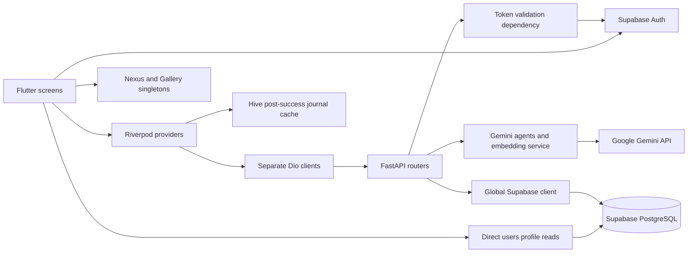
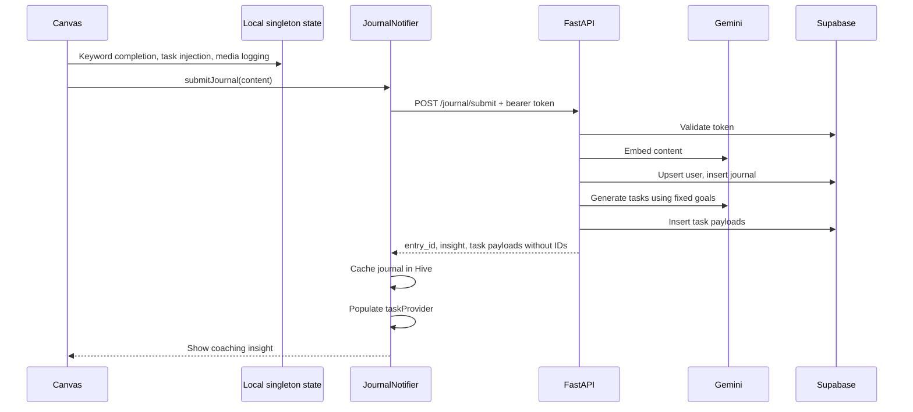

# Current architecture

> Baseline audit snapshot, before the implementation changes. See [current implementation](current-implementation.md), [progress tracker](implementation-progress.md), and [verification results](verification-results.md) for the updated state.

## Product and implementation status

The intended loop is: reflect on the day, understand intentions, propose small next actions, track execution, and review progress. The implementation currently contains two partly disconnected experiences: API-backed journal/profile/task logic, and a newer four-tab interface with local prototype state.

| Capability | Current implementation | Limitation |
| --- | --- | --- |
| Sign in | Supabase Google OAuth | Web callback is hardcoded; dev bypass conflicts with router guard |
| Onboarding | Four multiple-choice prompts, POST to FastAPI | Uses zero UUID instead of authenticated user; backend can report success after a failed write |
| Canvas reflection | Local chat UI plus real journal submission | Keyword rules change local tasks/media before server success |
| Journal understanding | Gemini schema-constrained task generation | Hardcoded goals, no uncertainty/deadline fields, no approval |
| Embedding | Generates requested 768-dimensional vector | Write-only; no similarity retrieval path |
| Nexus | Focus swapping, habits, keyword completion | In-memory singleton; separate from persisted backend tasks |
| Gallery | Seeded examples and keyword-based media logging | In-memory; percentages and correlations are fixed text |
| Resonance | Alignment, clarity, energy, focus cards | Static numbers, no computed backing data |
| Profile | Read/update goals and media via API | Stored goals are not used by journal agents |
| Task dashboard | Older `DashboardScreen` with Riverpod tasks/audit | Not included in router or tab shell |
| Weekly audit | API analyzes latest seven entries | No seven-day filter; actual UI is not wired to it |
| Image reflection | `ResonanceAgent` source exists | No registered route, upload flow, or UI integration |

## Component diagram

FastAPI is a single application process, not a distributed agent platform. Router functions coordinate database writes and model calls directly. Classes called agents are prompt wrappers around one model call each. There is no LangGraph, background worker, queue, workflow checkpoint store, or agent tool loop in the dependencies.

## Authentication and onboarding flow

1. `main.dart` opens three Hive boxes, initializes Supabase with hardcoded public project configuration, and starts a Riverpod `ProviderScope`.
2. `core/router.dart` checks `currentSession` during redirects. Unauthenticated navigation goes to `/login`.
3. Login uses `SupaSocialsAuth`; the callback reads `users.onboarding_complete` directly through Supabase.
4. The splash screen performs a similar direct profile read, choosing onboarding or `/dashboard`.
5. Onboarding posts its four selections with a fixed zero UUID and no bearer token. This differs from the authenticated ID used by login/profile reads.
6. `/dashboard` renders `MainNavigationShell` with Canvas, Nexus, Gallery, and Resonance. It does not render `DashboardScreen`.

The login dev-bypass button navigates to onboarding but does not create an authenticated session; the router guard can redirect it back to login.

## Current journal sequence

Local caching occurs only after the HTTP request succeeds. A cache error after server success is surfaced as submission failure. The API uses separate writes without a transaction, and retrying can duplicate entries/tasks. A model failure after the journal insert leaves partial data. Returned tasks omit database-generated IDs, so the task toggle contract is broken even if the older dashboard is connected.

## Boundaries that matter

- The client accesses Supabase directly for authentication and onboarding-status reads, while most domain writes use FastAPI. RLS is needed for direct client reads; server-side ownership checks are needed for all API operations.
- The configured backend key is loaded from `SUPABASE_SECRET_KEY`. Treat it as privileged; the checked source cannot establish the deployed key's permissions or RLS behavior.
- Hive data and singleton state are not partitioned by account. Logout behavior is inconsistent between the shell and profile screen.
- Gemini and database methods are synchronous despite being called from `async def` routes/services. They can block the event loop.
- There is no backend journal listing endpoint, current-task listing endpoint, deletion/export API, semantic-search API, or durable offline sync mechanism.

See [target system design](target-system-design.md) for the proposed replacement flow and [source inventory](source-inventory.md) for implementation pointers.
