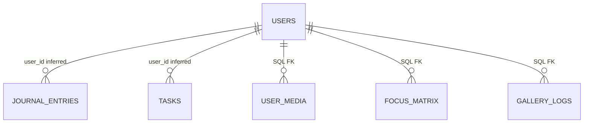

# Persistence and data model

> Baseline audit snapshot, before the implementation changes. See [current implementation](current-implementation.md), [progress tracker](implementation-progress.md), and [verification results](verification-results.md) for the updated state.

## What the repository establishes

Supabase supplies authentication and PostgreSQL access. The sole checked SQL file, `backend/supabase_migrations.sql`, extends pre-existing `users` and `journal_entries` tables and creates three additional tables. It does **not** bootstrap `users`, `journal_entries`, or `tasks`. Running it against an empty database will fail. No deployed schema, indexes, vector extension, auth-to-public-user trigger, or RLS policies were inspected.

The distinction between known SQL and inferred application contracts is essential: do not treat this page as executable base-schema DDL.

## Entity relationships

No source-entry foreign key connects generated tasks to journals. No checked SQL establishes the relationship between `auth.users` and public `users`; application IDs are intended to correspond, but the constraint/trigger is unknown.

## Tables and columns

| Table | Established by SQL | Inferred from application |
| --- | --- | --- |
| `users` | Added boolean `onboarding_complete` default false; JSONB `archetype_data` default `{}`; TEXT[] `macro_goals` default `{}`; VARCHAR(255) `primary_north_star`; JSONB `side_anchors` default `[]`; VARCHAR(50) `visual_theme` default Minimalist; VARCHAR(50) `ai_persona` default Therapeutic | Pre-existing `id`, `email`; exact base types/constraints unknown |
| `journal_entries` | Added TEXT `image_url`, TEXT `image_analysis_context`, FLOAT `visual_sentiment_score`, VARCHAR(7) `mood_color_hex` default `#E8D7F9` | `id`, `user_id`, `content`, `embedding`, `created_at`; vector service requests 768 values, database type unknown |
| `tasks` | No base DDL supplied | `id`, `user_id`, `title`, `description`, `xp_value`, `status`, `source`, `created_at` |
| `user_media` | UUID primary key default `gen_random_uuid()`; nullable user UUID FK to users with cascade; VARCHAR(50) `media_type`; NOT NULL VARCHAR(255) `title`; VARCHAR(50) `current_status`; timestamptz `updated_at` default now | Used by profile API |
| `focus_matrix` | UUID primary key; nullable user UUID FK with cascade; NOT NULL VARCHAR(255) `title`; boolean `is_primary` default false; timestamptz `updated_at` default now | No API/UI database use found |
| `gallery_logs` | UUID primary key; nullable user UUID FK with cascade; VARCHAR(50) `log_type`; NOT NULL VARCHAR(255) `title`; VARCHAR(50) `associated_mood`; boolean `auto_detected` default false; timestamptz `created_at` default now | No API/UI database use found |

`updated_at DEFAULT NOW()` initializes a row; no update trigger is provided to refresh it. Defaults do not imply NOT NULL. The three new user foreign keys are nullable in checked SQL. Media types and statuses are not check-constrained. A unique active primary focus is not enforced.

## Actual write/read paths

- Onboarding upserts the supplied ID, archetype fields, and primary north star. It does not populate the profile's `macro_goals` array.
- Journal and goal update upserts can overwrite `users.email` with a placeholder. Move profile creation to a single authenticated path that preserves verified identity data.
- Journal inserts content/vector, then separately inserts pending tasks; inserted task IDs are ignored.
- Profile reads `users` and `user_media`. Flutter login/splash also read `users` directly.
- Archive reads tasks by user and UTC creation date. Toggle updates tasks by ID alone.
- Embeddings are stored but never queried for nearest-neighbor matches. Adding vectors alone does not create retrieval-augmented generation.
- Local Gallery/Nexus data is independent of `gallery_logs`, `focus_matrix`, and `user_media`.

## Proposed migration plan

1. Export/reconcile the actual development schema before authoring a base migration. Compare types, constraints, RLS, auth trigger, indexes, and existing rows; do not blindly recreate populated tables.
2. Commit ordered migrations for extensions and base tables, auth ownership, then feature additions. Verify a clean database can be built from zero.
3. Require user ownership, timestamptz timestamps, input bounds/checks, and valid status/type constraints. Define journal/task deletion behavior deliberately.
4. Add `source_entry_id`, proposal/run identity, and task version fields. Add unique keys for idempotent generation/approval so duplicate requests cannot duplicate tasks.
5. Add `(user_id, created_at)` indexes for journals/tasks and appropriate owner indexes for media. Verify query plans before adding specialized indexes.
6. Decide whether `user_media` or `gallery_logs` is canonical; migrate into one model instead of building two feeds.
7. Keep embeddings in a separate versioned table keyed by source entry and embedding model/version, or add equivalent explicit metadata. Store actual dimensions; never mix model spaces in similarity search.
8. Introduce durable `workflow_runs`, `plan_proposals`, and transaction/outbox tables only as the workflow requires them. See [target design](target-system-design.md).

## Isolation and retrieval

For direct client access, enable and test RLS using authenticated user ownership. Do not assume a privileged server key obeys the same policies. Backend repositories must derive owner ID from authentication and filter reads/writes, including task toggle and workflow resume. Test with two different users and known foreign entity IDs.

Proposed retrieval should combine unfinished tasks, actual goals, recent entries, and a small number of semantically relevant historical excerpts. Put ownership filters into the database query/function before ranking or limiting. Exclude deleted/unapproved memory and the current entry when appropriate. Return source IDs so proposed plans can cite evidence.

PostgreSQL can supply vector storage/search through pgvector, already documented by Supabase; that avoids introducing another datastore initially. This capability is available in the platform but is not configured by this repository. See [Supabase pgvector documentation](https://supabase.com/docs/guides/database/extensions/pgvector).

## Retention and recovery

Define export/delete behavior for raw journals, generated proposals, embeddings, checkpoints, local caches, and backups. A deleted journal must stop appearing in retrieval. Avoid saving raw journals in traces by default. Use synthetic seed data and isolated databases for development. A free hosted database is not a complete backup/restore strategy; test a restore before public use.
