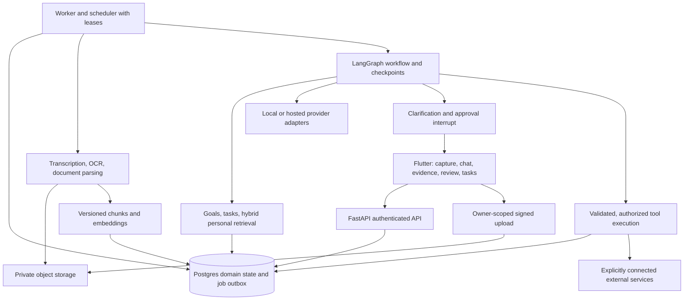

# LifeScript multimodal agent and automation implementation plan

> Implementation is now underway. See [implementation progress](implementation-progress.md) and [current implementation](current-implementation.md) for completed work and remaining gates. This document retains the original design/selection context.

Original status: proposal only. A subsequent user request authorized implementation; use the progress tracker for current status.

Prepared 22 October 2026. Extends [target system design](target-system-design.md) and [upgrade roadmap](upgrade-roadmap.md). This document defines the expanded multimodal scope; current implementation remains as described in [architecture](architecture.md).

## 1. Product outcome

Build a personal planning assistant that accepts typed reflections, recorded voice notes, images/screenshots, and PDFs/documents; retrieves relevant personal context; proposes grounded plans; and executes explicitly authorized actions with durable tracking.

Example journey: a user records a reflection about an exam, attaches a timetable screenshot and syllabus PDF, and asks for a study plan. LifeScript transcribes the recording, extracts dates/topics with source references, retrieves existing goals and commitments, asks about uncertain dates or missing availability, drafts a feasible plan, and shows proposed tasks/reminders. After approval it saves tasks and, if a calendar account was explicitly connected with write permission, creates selected calendar events. A scheduled review can later suggest adjustments based on actual completion.

The system does not infer clinical diagnoses, measured emotional improvement, or hidden psychological states from images, voice, or media consumption.

## 2. Scope and releases

| Release | Included | Completion evidence |
| --- | --- | --- |
| Reliable core | Auth/ownership, migrations, real task/media state, configuration, safe tests | Two-account end-to-end persistence and restart test |
| Agentic text | LangGraph, durable runs, typed extraction, clarification, plan review/approval | Resume after restart; rejected proposal creates no tasks |
| Personal RAG | Owner-scoped hybrid retrieval, evidence citations, memory controls | Labeled retrieval tests and deletion/isolation checks |
| Multimodal | Voice notes, images/screenshots, PDFs; source previews and corrections | Each modality produces a reviewable plan with traceable evidence |
| Automation | Durable schedules, permissioned tools, audit trail, one calendar integration | Retry/replay-safe execution, revoked access respected |
| Release hardening | Offline drafts/outbox, observability, evaluations, deployment and device checks | Reproducible setup and documented regression results |

Short-video ingestion and live voice conversation follow recorded-media workflows. Arbitrary-length video ingestion, autonomous web browsing, unrestricted tool execution, and multiple external integrations are outside the first release.

## 3. Architecture

Keep a modular FastAPI backend plus worker from the same repository. Postgres stores authoritative business state and durable jobs. LangGraph coordinates reasoning/state transitions; it is not the job scheduler, authorization system, or transaction manager. Store durable checkpoints in a supported Postgres checkpointer after verifying compatible pinned package versions. Define a backend-owned mapping from graph threads to authenticated owners.

## 4. Technology choices

| Layer | Plan | Rationale / boundary |
| --- | --- | --- |
| Client | Existing Flutter, Riverpod, GoRouter; typed repositories and one Dio client | Preserve app; replace disconnected singleton data |
| API/contracts | FastAPI, Pydantic, versioned API | Domain validation and generated/checked client contracts |
| Orchestration | LangGraph with checkpoints, conditional edges, interrupts | Stateful clarification/review and resumable execution |
| Data | Supabase Auth, Postgres, private Storage, pgvector | Reuse existing persistence; owner isolation throughout |
| Retrieval | SQL goals/tasks + Postgres full-text/vector hybrid search | Structured facts first; semantic history where beneficial |
| Local models | Ollama with evaluated text/vision and embedding models | No per-call API charge; actual hardware/model fit to be measured |
| Optional hosted models | Gemini through existing SDK behind adapter | Account/model/quota/terms checked at implementation; configurable IDs |
| Recorded speech | faster-whisper adapter | Local transcription; measure CPU/GPU latency and language accuracy |
| Documents | Docling with evaluated OCR configuration | Structured extraction and page provenance; isolate parsing workers |
| Tool interfaces | Typed Python tool registry; optional MCP adapters | MCP only when a trusted integration exposes useful capabilities |
| Background work | Durable Postgres outbox/job table, leases, bounded retries | Consistent enqueue and restart recovery without extra broker initially |
| Observability | Structured logs/metrics first; self-hosted Langfuse optionally | Redacted stage traces and model/prompt version history |
| Evaluation | pytest + synthetic fixtures, optional Promptfoo | Domain/replay tests and prompt/provider comparisons |
| Delivery | Docker/Compose, CI, isolated dev database | Reproducible setup; production hosting budget is separate |

Use current stable compatible versions when implementing and pin them. A newer model/framework name is not automatically a quality improvement; select using the benchmark. Do not install LangChain, LlamaIndex, multiple orchestration frameworks, and multiple vector stores without a distinct requirement.

## 5. Unified ingestion and evidence model

All accepted input becomes an owned `entry` with zero or more `assets`. Derived artifacts include transcripts, parsed pages, captions, chunks, embeddings, and structured observations. Each artifact records source asset/version, extractor/model version, status, and timestamps.

| Input | Processing | Evidence shown to user |
| --- | --- | --- |
| Text | Normalize, language/time context, structured extraction | Exact text spans |
| Voice recording | Transcribe, preserve segment timestamps, let user correct transcript | Audio timestamps and editable transcript |
| Image/screenshot | Validate/decode, OCR when relevant, vision extraction | Original image plus page/region/quoted text where available |
| PDF/document | Extract text/layout/tables with page metadata; OCR scanned pages | Document/page references and excerpts |
| Short video, later | Audio transcription plus bounded keyframe sampling | Timestamped audio/frame references |

Start with a bounded allowlist of formats and configurable size/duration/page limits. Verify actual file signatures, enforce upload quotas, keep objects private, use short-lived signed URLs, and run untrusted file parsing outside the API process with resource limits. Do not accept arbitrary remote fetch URLs initially. Preserve uncertainty from poor OCR/audio instead of inventing missing facts. Users should correct extracted dates/transcripts before consequential scheduling.

Use text transcripts/OCR/captions as the initial common retrieval representation. Evaluate direct multimodal embeddings later if image-to-image or cross-modal retrieval improves a real benchmark. Keep embedding spaces/model versions separate.

## 6. LangGraph workflow

Proposed graph: `load_owned_input -> normalize_and_extract -> retrieve_context -> validate_understanding -> clarify_if_needed -> draft_plan -> validate_plan -> await_review -> execute_authorized_actions -> verify_results -> summarize`.

- Input processing produces typed observations with evidence, not committed tasks.
- Retrieve actual goals, availability, pending tasks and relevant source excerpts.
- Deterministic checks enforce lengths, status enums, owner scope, duplicate/conflict handling, total time budget and date/timezone rules.
- Ambiguous deadlines, conflicting evidence and missing availability route to a persistent clarification interrupt.
- Proposal review uses a second interrupt for edit/approve/reject; persist proposal version and selected action IDs.
- Model output receives a bounded repair budget; exhausted retries become visible failures, not endless self-critique loops.
- Execution uses server-bound ownership and permission context. Recheck source/proposal versions and current policies before committing.
- Every database/external side effect has a stable action key. Graph node replay must not repeat an approved side effect.

Separate planning, retrieval and review into modules/nodes. Add specialist subgraphs only when tests show a benefit; a single supervisor spawning many agents is not a first-release requirement.

## 7. Personal RAG and memory

Maintain distinct stores for user-approved goals/preferences, task state, raw journal/assets, derived searchable artifacts, and versioned summaries. Keep conversational checkpoints separate from long-term user memory. Generated suggestions must not silently become user facts.

Retrieval: derive authenticated scope -> fetch structured current state -> owner-filter keyword/vector candidates -> merge/rank -> optionally rerank -> bound context -> return source IDs/excerpts. Apply permission filters before ranking/limiting. Evaluate hybrid retrieval against recent-history-only and vector-only baselines before adding reranking.

Add memory inspection, correction, retention preferences, export and deletion. Deletion must invalidate derived chunks/vectors/summaries and affected workflow context. Store sufficient provenance to rebuild artifacts. Follow-up questions should use dated evidence and distinguish user statements from model interpretation.

## 8. Automation and tools

Initial tools: list goals, retrieve evidence, list tasks, propose task updates, save approved tasks, propose reminders, inspect calendar availability, and create explicitly approved events. External calendar access requires its own OAuth connection, scopes and token lifecycle; app login alone does not grant calendar access.

| Automation | Default permission |
| --- | --- |
| Index new owned journal/assets | Automatic after accepted upload, under user's processing settings |
| Generate daily plan/weekly review | Opt-in schedule; creates draft only |
| Send user-selected reminder | Standing authorization limited to chosen channel/time scope |
| Create/edit tasks from a new proposal | Review by default; narrowly scoped standing rules can be added later |
| Write calendar event or send an external message | Explicit per-action approval initially |
| Delete/export data, expand integration scope | Explicit user action and authorization |

An automation rule records owner, trigger/schedule/timezone, allowed tools/action bounds, consent version, enabled state and last/next execution. Each execution records input versions, proposal/decision, action results and sanitized failure class. UI must allow pause, revoke and inspect history. Respect quiet hours and prevent reminder storms.

Use deterministic scheduler ticks to enqueue due rules, with uniqueness per scheduled occurrence. Account for timezone/DST, missed runs and restart. Apply retry caps/backoff, dead-letter state and user-visible retry controls. For external writes use provider idempotency when available; otherwise use stable remote identifiers/reconciliation. A timeout after a possible external success is an unknown outcome to reconcile, not permission to blindly repeat.

MCP is an optional connector protocol, not an authorization bypass. Allowlist trusted servers/tools, validate schemas and permissions, restrict scopes, and keep private journals out of unrelated tool calls. Begin with one real calendar adapter before expanding integrations.

## 9. Data/API additions

Extend reconciled migrations with entries/assets/artifacts, versioned chunks/embeddings, workflow runs/checkpoint ownership, proposals/decisions, automation rules/executions, tool-action ledger, connections and outbox/jobs. Reuse canonical users/tasks/media instead of building a second task subsystem.

Versioned APIs cover entry creation/listing, signed upload/finalization, asset processing status, run status/events, clarifications, proposals/decisions, tasks, memory search/forget, automation rules/history and integration connect/revoke. Use SSE for progress where practical with polling fallback. No model/provider credentials go to Flutter.

Use transactions for entry-plus-job and approval-plus-task writes. Sequential Supabase requests do not establish a transaction; implement reviewed RPC functions or a transaction-capable backend repository. Secrets and refresh tokens need protected storage, rotation and redacted logs. Store idempotency keys scoped by owner/operation with payload digests and stable prior responses.

## 10. Frontend experience

- Canvas: text/voice/image/document capture, upload/processing state, source previews, live progress, editable extraction, clarification and proposal cards.
- Nexus: canonical task board, dependencies/priorities/due dates, approval inbox and proposed replanning.
- Gallery: real owned assets/media with evidence links and processing status; remove invented correlations.
- Resonance: actual completed/planned work and dated source-backed reviews; label insufficient evidence.
- Automation center: rules, next runs, connection permissions, approvals, pause/revoke and execution history.
- Settings: provider/data-processing choice, retention, export/delete, notifications, timezone and memory controls.

Preserve drafts and account-specific offline outbox; never replay an account's queued operation with another account's token. Expose honest states: locally saved, uploaded, processing, awaiting review, executed, failed or outcome uncertain.

## 11. Implementation order and acceptance

1. **Foundation:** close auth/ownership defects, complete migrations, fix task IDs/listing, share API client, connect Nexus, correct logout. Gate: clean setup, two-user isolation and persistent task journey.
2. **Text graph:** introduce durable jobs/runs, provider interface, LangGraph checkpoints, extraction/clarification/review and replay-safe commit. Gate: model outage preserves entry; restart resumes; double approval creates one task set.
3. **RAG:** implement artifact/version/provenance model, hybrid retrieval and memory controls. Gate: no foreign/deleted sources; cited answers and measured relevance against baseline.
4. **Multimodal:** add signed assets, voice first, image/OCR next, PDF extraction next. Gate: each modality has bounded processing, correction UI, provenance and failed-processing recovery.
5. **Automation:** scheduled drafts/reviews/reminders, permissions/action ledger, then one calendar integration. Gate: revoked rule cannot execute; duplicate trigger does not duplicate actions; uncertain external outcome reconciles safely.
6. **Hardening:** synthetic benchmark, trace redaction, CI/containers, mobile/web auth/network checks, backup/restore, accessibility and offline replay. Gate: documented test/eval results and reproducible synthetic demo.

Ship each milestone before expanding scope. Calendar provider details, deployment budget and local model size can be chosen after account capabilities/hardware checks; they do not block foundation work. Avoid fixed delivery dates until the current auth/database/build baseline is exercised.

## 12. Quality gates and budget

Test auth/RLS, malicious input instructions, foreign-thread resume, file-format/size rejection, negation, ambiguous dates, OCR/transcription mistakes, conflicting task state, stale review, revoked tools, deletion during processing, worker crash and duplicate requests. Maintain modality-specific held-out examples. Track retrieval evidence precision/recall, action support, clarification quality, false completions, latency and resource/token usage. Define thresholds before comparing candidates; do not report targets as achieved scores.

Use local tools and synthetic fixtures for a zero-provider-fee development mode. Local inference still needs adequate hardware/electricity. Hosted free quotas, storage, public hosting, notifications and backups have separate limits. Unpaid Gemini services have personal/sensitive-data restrictions; do not use real private diaries as free-tier test prompts. Hosted production processing requires a deliberate data-policy/provider choice.

## Verified primary references

Checked 22 October 2026; capabilities/pricing must be rechecked during implementation.

- [LangGraph overview](https://docs.langchain.com/oss/python/langgraph/overview): orchestration for stateful workflows; LangChain is not required to use it.
- [LangGraph interrupts](https://docs.langchain.com/oss/python/langgraph/interrupts): persist and resume human-input boundaries; side effects still need replay safety.
- [Supabase AI and Vectors](https://supabase.com/docs/guides/ai): vector, keyword and hybrid retrieval guides and permission-aware RAG.
- [Ollama vision](https://docs.ollama.com/capabilities/vision): image-plus-text model input; select an evaluated model appropriate to hardware.
- [faster-whisper](https://github.com/SYSTRAN/faster-whisper): local speech transcription through CTranslate2.
- [Docling](https://docling-project.github.io/docling/): structured document conversion with OCR/layout tooling.
- [MCP architecture](https://modelcontextprotocol.io/docs/learn/architecture): connector/tool protocol; authorization remains application responsibility.
- [Langfuse self-hosting](https://langfuse.com/self-hosting): self-hosted observability, with separate infrastructure and optional licensed features.
- [Promptfoo](https://www.promptfoo.dev/docs/intro/): local prompt/provider evaluations; model calls can still carry charges.
- [Gemini model catalog](https://ai.google.dev/gemini-api/docs/models), [pricing](https://ai.google.dev/gemini-api/docs/pricing), [terms](https://ai.google.dev/gemini-api/terms): verify available models, quotas and permitted data processing rather than hardcoding a latest-model assumption.
