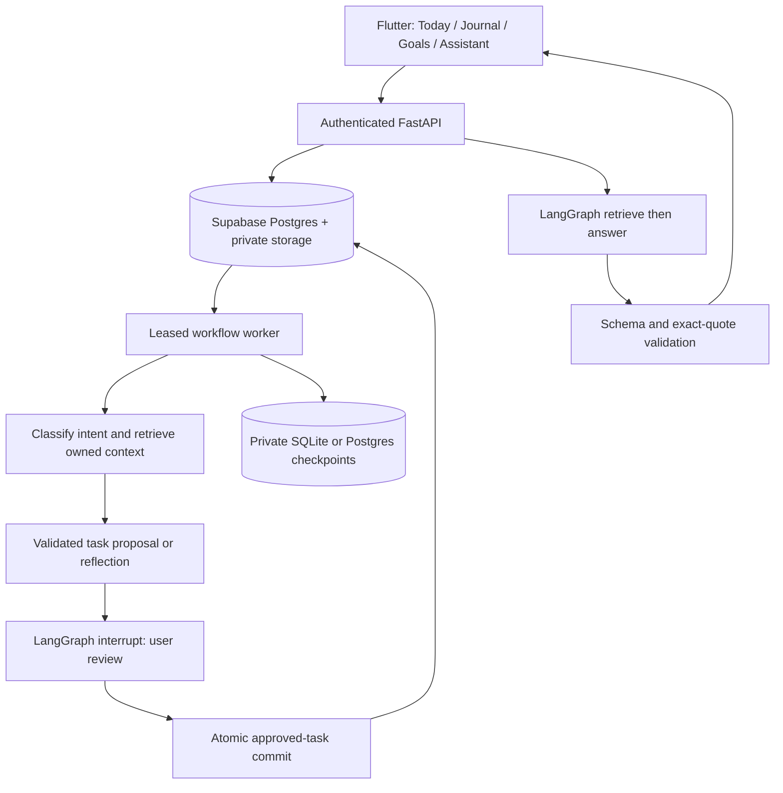

# LifeScript portfolio and interview guide

LifeScript turns personal journal entries into user-reviewed tasks and connects those tasks to goals and projects. Its assistant retrieves owned journal context and includes validated source quotes. Flutter provides Today, Journal, Goals and Assistant screens; FastAPI, Supabase/PostgreSQL, pgvector, Pydantic and LangGraph implement the backend.

## Suggested project bullets

- Built a Flutter/FastAPI personal planning app with authenticated journal capture, editable task proposals, goal/project organization and persisted task completion.
- Implemented a LangGraph workflow with intent classification, bounded structured extraction, clarification/review interrupts, private checkpoints, leased jobs and atomic idempotent task commits.
- Developed personal RAG using owner-filtered vector/full-text retrieval, versioned embeddings and a conversational assistant with validated evidence quotations and bounded conversation context.
- Added account-isolation regressions, real-SDK provider contract tests, ordered database migrations, synthetic model evaluations and CI configuration.

Use these as implementation claims. Add deployment, user counts, latency or accuracy numbers only when you have corresponding evidence. Do not present CI as executed merely because its workflow file exists. Current executed results and remaining limitations are in [verification results](verification-results.md).

## A focused demonstration

1. Sign in with a development account. Show an empty account, not someone else's data.
2. Create a goal such as Learn backend engineering and a project such as Build a retrieval pipeline.
3. Journal: ?I want to review my Python notes for twenty minutes tomorrow.? Show Saved and Processing as separate states.
4. Review the proposed task and its evidence. Edit it if useful, then approve. Demonstrate that it was absent from Today before approval.
5. Link the task to the project from Today, complete it, and show actual linked-task counts in Goals.
6. Ask the Assistant what you wrote about Python. Expand its source quote. Explain that chat cannot silently complete tasks or perform external actions.
7. Show tests and the architecture below. If quota is unavailable, show the honest error/retry state instead of presenting mocked output as live.

## Architecture to explain

## Engineering decisions to discuss

Journals persist before generation; a provider outage does not imply a lost entry. Stable operation IDs and database transactions prevent duplicate saves/commits. Owner predicates and composite foreign keys prevent cross-account task links. Human approval is separate from model output. Retrieval falls back to keyword search when embeddings fail and reports that mode. Schema and exact evidence checks constrain output but do not eliminate semantic hallucinations. Private checkpoints and account-scoped screen state protect context across restarts and account changes.

## Remaining release work

Use the current verification log for live-service outcomes. Native-device behavior, production deployment, backup/restore, calendar OAuth, optional audio/OCR quality and broad held-out retrieval/extraction benchmarks need separate evidence. The UI shows bounded loaded-task progress rather than claiming a complete lifetime metric. Full offline synchronization and encrypted local draft storage are not implemented.
