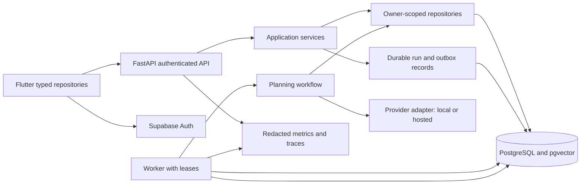

# Proposed target system design

> Implementation is now underway. See [implementation progress](implementation-progress.md) and [current implementation](current-implementation.md) for completed work and remaining gates. This document retains the original design/selection context.

**Status: design proposal, not implemented.** Keep Flutter, FastAPI, and Supabase. Build a modular backend and one durable journal-to-plan workflow before introducing more services.

## User-visible behavior

Writing a journal saves the entry promptly, even if AI is unavailable. A separate processing state shows whether suggestions are queued, running, awaiting clarification, or ready for review. The user can edit/reject suggestions before canonical tasks are created. Nexus shows persisted tasks; Gallery shows confirmed media; Resonance shows evidence-backed review summaries.

## Logical architecture

The worker may run from the same repository/image as the API with a separate command. This is a modular monolith plus a worker, not a reason to split into independent microservices. Initially use a PostgreSQL job table; add a dedicated broker only when throughput or operational requirements justify it.

## Suggested backend modules

| Module | Responsibility |
| --- | --- |
| `api/routers` | HTTP validation, auth dependency, response codes |
| `application/journals` | Save entry and enqueue enrichment transactionally |
| `application/planning` | Context selection, proposal lifecycle, approval orchestration |
| `domain` | Entities, statuses, ownership rules, deterministic plan validation |
| `repositories` | Owner-scoped query/write interfaces and transaction boundary |
| `providers` | Structured generation and embedding interfaces, Gemini/Ollama adapters |
| `workflows` | State transitions, checkpoint integration, bounded routing |
| `workers` | Claim jobs, renew leases, retry, recover interrupted runs |
| `observability` | Request/run IDs, redaction, metrics and provider timings |

Avoid doing a directory-only rewrite. Extract one tested vertical flow at a time from current routers.

## Proposed API evolution

Use `/v1` for the new contract while explicitly migrating clients. These routes are suggestions, not existing endpoints.

| Method / path | Behavior |
| --- | --- |
| POST `/v1/journals` | Validate and save journal plus run/outbox in one transaction; return 201 with entry/run IDs |
| GET `/v1/journals?cursor=...` | Paginated owner history, including enrichment status |
| GET `/v1/runs/{id}` | Owner-scoped status/proposal or sanitized error; client polls with backoff |
| POST `/v1/runs/{id}/clarifications` | Validate current run state/version and resume with user answer |
| GET `/v1/proposals/{id}` | Reviewable tasks, evidence, assumptions, proposal version |
| POST `/v1/proposals/{id}/decision` | Approve/edit/reject explicit items; idempotent transaction |
| GET `/v1/tasks?status=pending&cursor=...` | Canonical task list |
| PATCH `/v1/tasks/{id}` | Owner/version-checked update; conflict on stale version |
| GET `/v1/reviews?period=...` | Persisted dated review with sources, not a new generation on every GET |
| DELETE `/v1/journals/{id}` | Delete/tombstone source and invalidate related retrieval/workflow context |

Require idempotency keys for create/decision requests. Scope unique keys by owner and operation; record a request digest and reject reuse with a different payload. Return the prior stable outcome for an identical retry. Pagination and maximum page/body sizes should be explicit. Define consistent errors with `code`, safe `message`, `request_id`, and optional field details.

## Durable workflow and persistence

Suggested run states: `queued`, `running`, `awaiting_clarification`, `awaiting_review`, `completed`, `failed`, `cancelled`. State changes must be guarded by expected state/version. Distinguish transient failures from permanent invalid-input failures.

1. In one database transaction, save journal, run, and outbox/job. If any write fails, none should commit.
2. Worker atomically claims eligible work with a lease. Prevent concurrent processing of the same run; recover expired leases after crashes.
3. Read owner-scoped context and version it. External generation occurs outside a long-held database transaction.
4. Persist the proposal and transition to review. A transient provider failure retries with exponential backoff/jitter, a fixed attempt cap, and a user-visible retry state.
5. On approval, recheck owner, proposal version, source deletion, and goal/task conflicts. Insert tasks and record decision/run completion in one transaction.
6. Enforce unique `(proposal_id, proposal_item_id)` or equivalent to deduplicate task commits. External API calls are at-least-once in practice; database side effects must tolerate replay.

The current chain of Supabase `.execute()` calls is not a transaction. Implement transactional operations using a carefully authorized database function/RPC or a transaction-capable backend database layer. Do not claim atomicity from sequential requests. If using LangGraph checkpoints, keep authenticated thread-to-owner mapping and design side effects to be safe when nodes replay after an interrupt.

## Context, indexes, and scaling

Start with chronological entries and pending-task SQL queries. Add vector search once benchmarked. Use owner/date indexes and bounded top-k results; add approximate vector indexes after observing latency and data volume. Keep model/dimension versions isolated.

Capacity example, **not a benchmark or provider quota**: 100 active users writing two entries/day produces 200 runs/day. At two generation calls and one embedding per run, that is roughly 400 generation requests and 200 embedding requests/day before repairs/audits. Peak arrivals, token volume, and actual account quotas matter more than the daily mean. Use `required concurrency ≈ peak runs/second × observed seconds/run`, then cap it by provider and database limits. Queue bursts rather than spawning unbounded requests.

A 768-value float32 vector is 3,072 bytes before row/index overhead; 10,000 vectors alone are about 30.7 MB. Journal text, versions, workflow checkpoints, and vector indexes can dominate a small database. Measure actual table/index sizes and prune unnecessary snapshots; do not estimate capacity from vectors alone.

## Offline and synchronization

First provide local account-scoped draft persistence. Next, introduce a client outbox with stable operation IDs and states `draft`, `queued`, `syncing`, `synced`, `failed`. Backend idempotency handles duplicate sends. Keep authoritative task state server-side; reconcile by ID/version. Show save/generation/approval as separate states. On logout, close or clear account-specific caches and invalidate all providers; never replay user A's outbox with user B's token.

## Observability and operational goals

Record request/run IDs, stage duration, provider model/version, token counts where available, retry counts, queue depth/age, validation failures, and final status. Keep content capture off by default. Start with structured logs and counters; add a self-hosted trace tool when useful.

Proposed starting targets: journal-save p95 under 500 ms in a local fake-provider test, no duplicate committed tasks under replay, zero cross-owner access in tests, and complete recovery of queued/review states after process restart. Measure real enrichment latency before promising an SLA. Alert on growing queue age, elevated failures, expired leases, and provider quota exhaustion.

## Tradeoffs and deferred choices

| Choice | Reason | Revisit when |
| --- | --- | --- |
| Keep Supabase/Postgres | Existing auth/data investment; SQL and vectors in one place | Measured platform constraints or portability requirement |
| Keep one backend repository | Easier transactions, debugging, deployment | Teams/workloads require independent ownership/scaling |
| Durable DB queue first | Fewer dependencies and recoverable work | Contention/throughput needs a dedicated broker |
| Poll run status first | Simple, testable mobile/web behavior | Real-time progress materially improves UX; then consider SSE |
| One planner workflow | Clear user value and bounded evaluation | Distinct tools/problems justify additional workflows |
| Local provider option | Private experimentation without per-call API fees | Hardware/quality constraints require a reviewed hosted option |
| No automatic external writes | User approves meaningful side effects | Explicit integration consent, scopes, and rollback semantics are implemented |

Do not add Kubernetes, Kafka, multiple vector databases, autonomous browser actions, or fine-tuning before basic correctness, measured load, and evaluation justify them.
